# Evolução do Sistema do Grupo05 Seguros: Novos Produtos, Modernização Tecnológica e Acessibilidade

**Universidade Virtual do Estado de São Paulo — UNIVESP**  
**Bacharelado em Tecnologia da Informação — Projeto Integrador II**

Bruno Matteelli Neto de Oliveira, RA 2108279  
Fabio Cordeiro de Souza, RA 23207163  
João Pedro Thomaz Silva Oliveira, RA 23211304  
Nathaly Carvalho Gonçalves, RA 2214013  
Paula Melissa da Silva Leitão, RA 24207504  
Pedro Henrique Rodrigues Oliveira, RA 24208890

Cajamar, Embu das Artes, Jandira, Santana de Parnaíba, São Bernardo do Campo – SP  
2026

## RESUMO

Este trabalho apresenta a evolução do sistema web do Grupo05 Seguros a partir da solução de cotação de seguro de automóvel desenvolvida no Projeto Integrador I. O problema investigado consiste em ampliar a coleta e a organização de solicitações para novos produtos, reduzir a repetição de dados e melhorar a manutenção e a experiência de uso da plataforma. O objetivo é consolidar, no Projeto Integrador II, uma solução para automóvel, seguro residencial e cartão de crédito, acompanhada de modernização tecnológica, recursos de acessibilidade e mecanismos de segurança. A pesquisa caracteriza-se como aplicada, de abordagem qualitativa, apoiada no Design Thinking, na análise documental e na inspeção do código-fonte. A implementação utiliza Angular e TypeScript na interface, Node.js e Express em JavaScript na API, MySQL na persistência, Flyway para versionamento do banco e Docker Compose para configuração dos serviços. Os resultados técnicos incluem formulários condicionais por produto, cadastro compartilhado de segurados, APIs específicas, transações para gravação de cotações, autenticação por token, proteção de senhas com Argon2id, temas claro e escuro e automação de testes e publicação. Na verificação da versão analisada, 201 testes automatizados do backend foram aprovados. A análise também identificou limitações relacionadas à autorização por perfil e à ausência de avaliação completa de acessibilidade e de indicadores operacionais. Conclui-se que a solução amplia o escopo funcional estabelecido no PI I e melhora a organização técnica do sistema, enquanto a comprovação de impacto no atendimento requer avaliação de campo e mensuração posterior.

**Palavras-chave:** Sistema web; Cotação; Design Thinking; Acessibilidade digital; Engenharia de software.

## 1 INTRODUÇÃO

A coleta de informações para solicitação de produtos financeiros e seguros exige organização, clareza e consistência. Em uma corretora, dados incompletos ou repetidos podem aumentar o trabalho de conferência e dificultar a continuidade do atendimento. O Grupo05 Seguros constitui a comunidade externa deste projeto, representada nos registros anteriores pela sócia-fundadora Carla Matos. A necessidade de estruturar o cadastro de clientes potenciais orientou o desenvolvimento inicial de uma aplicação para solicitações de seguro de automóvel.

O Projeto Integrador I estabeleceu uma base funcional com autenticação, cadastro de usuários e clientes e registro de solicitações de cotação de automóvel, utilizando PHP, Laravel, Blade e MySQL. Seu relatório final descreve a substituição de parte dos controles dispersos por formulários e consultas centralizados, além da revisão das telas a partir da interação com a representante da corretora (SOUZA, 2025). Essa experiência constitui o ponto de comparação deste trabalho.

No planejamento e no relatório parcial do Projeto Integrador II, foram identificadas novas necessidades: incorporar seguro residencial e cartão de crédito, revisar a organização dos formulários, ampliar a atenção à acessibilidade e facilitar a manutenção do sistema. A continuidade da solução exigiu conciliar essas demandas de negócio com uma estrutura técnica que permitisse evoluir os módulos sem reproduzir dados e regras de maneira desnecessária (SOUZA; LIMA, 2025).

O problema de pesquisa é formulado da seguinte maneira: como evoluir o sistema de cotação desenvolvido no PI I para registrar solicitações de diferentes produtos, com melhor organização das informações, recursos de acessibilidade e uma arquitetura que facilite testes e manutenção? A investigação considera tanto a interface utilizada pela equipe da corretora quanto as regras e estruturas responsáveis pela persistência dos dados.

Este relatório consolida a evolução funcional e tecnológica documentada e distingue as propostas do parcial das funcionalidades encontradas na versão de 31 de outubro de 2026. Essa delimitação temporal evita pressupor que todas as melhorias já estivessem implementadas na data do documento parcial.

A contribuição central consiste na passagem de um fluxo concentrado em automóvel para uma plataforma que compartilha o cadastro do segurado e separa as informações específicas de cada produto. A modernização da interface e da arquitetura acompanha essa ampliação. A avaliação distingue resultados de implementação, evidências de testes e benefícios esperados, evitando atribuir reduções de custos ou aumentos de conversão sem dados de acompanhamento.

## 2 DESENVOLVIMENTO

### 2.1 Objetivo geral

Evoluir o sistema web do Grupo05 Seguros desenvolvido no Projeto Integrador I, ampliando o registro de solicitações para automóvel, seguro residencial e cartão de crédito, com modernização da arquitetura, melhoria da experiência de uso, recursos de acessibilidade e fortalecimento dos mecanismos de segurança e verificação de software.

### 2.2 Objetivos específicos

a) Reorganizar o fluxo de cotação de automóvel e apresentar campos e validações compatíveis com o produto selecionado.

b) Implementar o registro de solicitações de seguro residencial e cartão de crédito, com reaproveitamento do cadastro do segurado e regras próprias para cada modalidade.

c) Separar interface, serviços de aplicação e persistência, favorecendo manutenção, reutilização e testes automatizados.

d) Incorporar organização semântica dos formulários, identificação de controles, indicação de foco e adaptação da interface a diferentes dimensões de tela, utilizando WCAG 2.1 e WAI-ARIA como referências.

e) Aplicar autenticação, proteção de senhas, validação de entradas e consistência transacional, identificando os controles de autorização que ainda dependem de complementação.

f) Estruturar o versionamento do banco e a configuração dos ambientes, além da execução automatizada de testes e da preparação de novas versões.

g) Avaliar a implementação por inspeção e testes técnicos e estabelecer um procedimento de validação com a comunidade externa que permita mensurar usabilidade e efeitos operacionais.

### 2.3 Justificativa e delimitação do problema

O cadastro centralizado desenvolvido no PI I oferece uma base para ampliar o relacionamento da corretora com seus clientes. Entretanto, a coleta estruturada apenas para automóvel limita o uso do sistema em atendimentos que envolvem outros produtos. A expansão para residencial e cartão de crédito exige formulários próprios, pois endereço do imóvel, informações do veículo, renda e ocupação correspondem a necessidades diferentes.

A justificativa funcional é permitir que um mesmo segurado seja associado a solicitações distintas, reduzindo a necessidade de repetir seu cadastro. Essa organização favorece a consulta e pode apoiar a oferta de produtos complementares, frequentemente denominada venda cruzada. O registro de diferentes interesses, por si só, não comprova aumento de vendas; constitui uma condição de apoio ao atendimento que precisa ser avaliada na operação.

A justificativa técnica está relacionada à manutenção e à verificação do software. A separação de responsabilidades facilita localizar regras de negócio, testar comportamentos e modificar interfaces. A decisão de substituir a base PHP/Laravel por Angular e uma API Node.js foi uma escolha de organização e evolução do projeto. Não decorre de uma incapacidade inerente do PHP ou do Laravel de atender a aplicações semelhantes.

A relevância social do trabalho relaciona-se à redução de barreiras no uso de serviços digitais e à organização do atendimento. Formulários claros e controles identificados podem beneficiar pessoas com diferentes níveis de familiaridade tecnológica. A avaliação dessa contribuição exige considerar usuários reais e tecnologias assistivas, além da observação visual da interface.

O escopo compreende a gestão de usuários, segurados e solicitações, incluindo consulta, inclusão, alteração, desativação e reativação conforme o recurso. O termo cotação designa, neste sistema, o registro das informações necessárias para encaminhar uma solicitação. A aplicação não calcula prêmios, não compara preços de seguradoras e não emite apólices. O módulo de cartão de crédito registra interesse e dados de solicitação; não realiza análise de crédito, aprovação ou emissão de cartão.

Não integram a entrega comprovada: contratação automática, gestão financeira, notificações de vencimento, recomendação de produtos por inteligência artificial, aplicativo móvel nativo e integração transacional com seguradoras ou emissores. Tampouco foi identificada uma estrutura completa de funil comercial, histórico de contatos ou acompanhamento de negociações. Essas funções permanecem como possibilidades de evolução.

### 2.4 Fundamentação teórica

#### 2.4.1 Design Thinking e desenvolvimento orientado às pessoas

O design centrado nas pessoas utiliza a compreensão do contexto, a geração de alternativas e a experimentação para orientar decisões de projeto. Os métodos apresentados pelo IDEO.org incluem entrevistas, definição do desafio e alinhamento de objetivos de impacto, articulando a compreensão das necessidades com a construção de soluções (IDEO.ORG, s.d.). Neste trabalho, essa abordagem estrutura as atividades de ouvir, criar e implementar.

A escuta identifica dificuldades do atendimento e limitações dos formulários; a criação transforma essas necessidades em fluxos e requisitos; a implementação permite avaliar o comportamento da solução. A repetição desse ciclo depende do registro das observações e das mudanças realizadas. Assim, uma afirmação genérica de satisfação deve ser complementada, quando possível, por tarefas executadas, dificuldades observadas e decisões decorrentes da avaliação.

#### 2.4.2 Acessibilidade e usabilidade

As WCAG 2.1 apresentam critérios verificáveis para acessibilidade de conteúdo web. Neste projeto, orientam a análise de identificação de campos, operação por teclado, foco visível, contraste e apresentação de erros. A adoção desses critérios contribui para organizar a avaliação e exige verificar as páginas e os processos completos, inclusive os estados de erro e as variações de tema (W3C, 2025).

A WAI-ARIA define papéis, estados e propriedades que comunicam informações semânticas às tecnologias assistivas. No sistema, atributos como aria-label, aria-labelledby e aria-pressed ajudam a identificar controles e estados de seleção (W3C, 2023). Seu uso complementa os elementos HTML e os componentes da interface. A presença desses atributos e do modo escuro representa uma implementação parcial de recursos; não constitui comprovação de conformidade integral com as WCAG.

#### 2.4.3 Arquitetura web e separação de responsabilidades

Na documentação do Angular, os componentes organizam a interface por meio de lógica, template e estilos. Essa divisão fornece uma base para estruturar formulários e páginas reutilizáveis (ANGULAR, s.d.). Na solução analisada, o frontend utiliza Angular, TypeScript e componentes do Angular Material, com serviços responsáveis pela comunicação HTTP.

O Express organiza endpoints e associa métodos HTTP a funções de tratamento e middlewares (EXPRESS, s.d.). A API do projeto distribui rotas, validadores, serviços e repositórios por domínio. O Node.js oferece operações assíncronas de entrada e saída, úteis na comunicação com bancos e serviços externos (NODE.JS, s.d.). Essa característica não elimina a necessidade de avaliar consultas, consumo de recursos e concorrência antes de afirmar ganhos de desempenho ou escalabilidade.

#### 2.4.4 Integridade de dados e evolução do banco

Transações permitem agrupar operações para confirmar mudanças ou desfazê-las em caso de falha. No MySQL, os comandos de início, confirmação e reversão de transação dão suporte à coordenação dessas alterações (ORACLE, s.d.). Esse conceito fundamenta a gravação conjunta dos dados comuns de uma cotação e dos detalhes de seu produto.

O Flyway utiliza scripts versionados e repetíveis para aplicar mudanças de estrutura e dados e manter um histórico das migrações (REDGATE, 2025). O repositório organiza as alterações do banco em uma trilha comum e diretórios específicos de ambiente, tornando explícita a relação entre a versão do código e a estrutura exigida para sua execução.

#### 2.4.5 Segurança, autenticação e autorização

A autenticação verifica a identidade apresentada pelo usuário, enquanto a autorização define quais ações essa identidade pode executar. A OWASP recomenda validação de permissões em cada requisição e adoção do menor privilégio necessário (OWASP, s.d.a). Portanto, possuir um token válido e cadastrar perfis não basta para demonstrar que as operações administrativas estejam restritas corretamente.

Para armazenamento de senhas, a OWASP recomenda funções de derivação apropriadas, entre elas Argon2id, com parâmetros adequados (OWASP, s.d.b). O projeto utiliza Argon2id para gerar e verificar hashes. A avaliação de segurança considera também validade de tokens, proteção das configurações, controle de acesso e comportamento do sistema após alterações de conta.

#### 2.4.6 Versionamento, ambientes e automação

O controle de versão registra mudanças e permite recuperar estados anteriores do trabalho, favorecendo rastreabilidade e colaboração (CHACON; STRAUB, 2014). No projeto, Git e GitHub apoiam a organização das alterações de código e configuração.

O Docker Compose descreve e coordena serviços de uma aplicação em arquivos de configuração, com parametrização por ambiente (DOCKER, s.d.). O GitHub Actions permite automatizar compilação, testes e publicação a partir de eventos do repositório (GITHUB, s.d.). Esses recursos dão suporte à repetição dos procedimentos de entrega, embora a existência do fluxo configurado deva ser distinguida da comprovação de cada execução em produção.

### 2.5 Aplicação dos conhecimentos do curso

O projeto articula conteúdos de desenvolvimento web, programação, banco de dados, engenharia de software, interação humano-computador e infraestrutura. A relação entre esses conhecimentos e os artefatos é apresentada no Quadro 1. A correspondência com os nomes oficiais das disciplinas deve seguir a matriz curricular da turma.

**Quadro 1 — Conhecimentos aplicados e evidências na solução**

| Área de conhecimento | Aplicação no projeto | Evidência observável |
| --- | --- | --- |
| Desenvolvimento web | Navegação, componentes, formulários e comunicação HTTP | Componentes Angular e rotas Express |
| Programação | Modelos tipados na interface e funções assíncronas na API | Arquivos TypeScript do frontend e JavaScript do backend |
| Banco de dados | Relacionamentos, restrições e transações | Migrações SQL e repositórios |
| Engenharia de software | Separação de responsabilidades e verificação de regras | Módulos por domínio e testes automatizados |
| Interação humano-computador | Organização dos campos, feedback e recursos de acessibilidade | Templates, estilos e componentes de confirmação |
| Segurança da informação | Autenticação, hashing e identificação de permissões pendentes | JWT, Argon2id e análise dos middlewares |
| Infraestrutura e versionamento | Ambientes, containers e preparação de releases | Docker Compose, Git e GitHub Actions |

Fonte: elaboração do grupo a partir do repositório analisado, 2026.

### 2.6 Metodologia

#### 2.6.1 Natureza da pesquisa e fontes de evidência

A pesquisa é aplicada e qualitativa, com desenvolvimento de uma solução para um problema de uma comunidade externa. O procedimento combina análise documental, levantamento de requisitos descrito nos registros do projeto, inspeção estática da implementação e execução de testes técnicos. A unidade de análise é o sistema de gestão de segurados e solicitações do Grupo05 Seguros.

Foram utilizados como fontes a documentação da solução inicial, o relatório parcial do PI II, o acervo técnico fornecido pelo grupo e a versão local do código-fonte. Os documentos apoiam a compreensão da trajetória e das necessidades; o código e os testes permitem verificar o estado técnico da implementação. As descrições históricas de uso e satisfação são tratadas como registros documentais, sem substituírem uma nova observação de campo.

A verificação técnica foi realizada sobre o commit b3a12b3, de 31 de outubro de 2026. A suíte de backend foi executada em cópia temporária do código, com as dependências do arquivo de lock e sem conectar ao banco de produção. Foram utilizados Node.js 18.19.1, npm e o executor nativo de testes. O fluxo de integração contínua do repositório prevê Node.js 22; por isso, a execução local constitui uma evidência complementar e não substitui a execução nesse ambiente.

#### 2.6.2 Ouvir: compreensão do problema

Os registros do PI I e do parcial descrevem a participação da representante da corretora na identificação de dificuldades e na avaliação dos formulários. As demandas recorrentes incluem clareza das informações, redução da repetição de dados e organização de solicitações. O parcial acrescenta a necessidade de novos produtos, melhorias de acessibilidade e revisão da estrutura técnica.

Essas informações foram sintetizadas em requisitos verificáveis. A necessidade de atender diferentes produtos resultou na seleção de modalidade e em dados específicos; a repetição de cadastros foi tratada pelo vínculo entre segurado e solicitação; a manutenção motivou a separação entre interface, API e persistência. Não foram acrescentadas novas entrevistas, datas, depoimentos ou quantidades de participantes sem documentação correspondente.

#### 2.6.3 Criar: requisitos e prioridades

A técnica MoSCoW foi mantida como instrumento de organização já utilizado no parcial, distinguindo requisitos essenciais, desejáveis e posteriores. A revisão associa cada prioridade a um critério de aceitação e ao estado encontrado na implementação, conforme o Quadro 2.

**Quadro 2 — Priorização dos requisitos e situação verificada**

| ID e prioridade | Requisito | Critério de aceitação e situação |
| --- | --- | --- |
| RF01 — Obrigatório | Reutilizar cadastro do segurado | Solicitações referenciam um cadastro existente. Implementado. |
| RF02 — Obrigatório | Cotação de automóvel | Validar dados de veículo e condutor. Implementado. |
| RF03 — Obrigatório | Seguro residencial | Validar endereço do imóvel sem exigir veículo. Implementado. |
| RF04 — Obrigatório | Cartão de crédito | Validar renda positiva e ocupação. Implementado. |
| RNF01 — Obrigatório | Recursos de acessibilidade | Controles identificados e foco previsto; avaliação integral pendente. Parcial. |
| RNF02 — Obrigatório | Autenticação e autorização | Token exigido na API; restrição por perfil ainda não demonstrada. Parcial. |
| RNF03 — Obrigatório | Manutenção e testes | Camadas separadas e testes reproduzíveis. Implementado no escopo verificado. |
| RF05 — Desejável | Indicadores básicos | Contagens de cadastros disponíveis; relatórios comerciais completos pendentes. Parcial. |
| RF06 — Desejável | Integração com fornecedores e notificações | Retorno de preços e alertas automáticos. Não implementado. |
| RF07 — Posterior | Recomendações e chatbot | Funcionalidades fora da entrega comprovada. |
| RF08 — Fora do escopo | Aplicativo nativo e gestão financeira | Não incluídos nesta versão. |

Fonte: elaboração do grupo a partir do parcial e da inspeção do sistema, 2026.

#### 2.6.4 Implementar: construção e verificação

A solução foi organizada em componentes de interface, serviços HTTP, rotas de API, validadores, serviços de negócio e repositórios. As modificações de banco foram descritas em migrações e os serviços foram configurados em arquivos Docker Compose. Essa estrutura permite rastrear uma ação do formulário até sua persistência.

A verificação combinou leitura das regras e execução dos testes existentes. Foram observados casos de autenticação, validação de entradas, cadastros, produtos de cotação e restrição de operações ao produto correspondente. Também foram examinadas as fronteiras da implementação, como a diferença entre uma tela exibida e uma operação efetivamente persistida.

Para registrar as telas da solução, o frontend e a API do repositório foram executados localmente, sem alterações nos componentes ou estilos. Um banco MySQL 8.4 temporário e vazio recebeu as oito migrações comuns por meio do Flyway 12.4. Foram criados, pela API, usuários, segurados e solicitações com dados exclusivamente fictícios. Foram selecionadas onze capturas desktop, em janela de 1440 pixels de largura, e 22 capturas mobile, em área de visualização de 390 × 844 pixels CSS, com emulação de toque no navegador. Os registros incluem autenticação, consultas, formulários, menu e alternância de tema. Nos formulários móveis, a rolagem foi registrada em vistas sequenciais. Esse procedimento documenta a interface atual e não substitui a avaliação com a comunidade externa, o uso em dispositivos físicos nem os testes sistemáticos de integração.

#### 2.6.5 Avaliação com a comunidade externa

O relatório parcial registra retorno favorável da representante da corretora sobre clareza e navegação dos protótipos. Esse retorno constitui evidência qualitativa da etapa documentada, mas não comprova a aceitação de todas as alterações presentes no repositório atual. Para avaliar a versão consolidada, foi estruturado o roteiro do Apêndice A.

O roteiro prevê tarefas reais de cadastro, criação e alteração de solicitações, com registro de conclusão, dificuldades, erros e tempo de execução. A avaliação deve observar também teclado, visualização em tela reduzida e tecnologias assistivas. Como não foi disponibilizada uma ata dessa aplicação à versão atual, seus resultados não são apresentados como concluídos neste relatório.

## 3 RESULTADOS: SOLUÇÃO CONSOLIDADA

### 3.1 Comparação entre o PI I e o PI II

A comparação toma o relatório final do PI I como descrição da solução de origem e utiliza o código atual para caracterizar a evolução consolidada no PI II. Isso evita atribuir ao sistema inicial limitações que não foram demonstradas e permite identificar mudanças concretas no escopo e na organização técnica.

**Quadro 3 — Evolução da solução em relação ao PI I**

| Dimensão | Solução descrita no PI I | Evolução consolidada no PI II |
| --- | --- | --- |
| Produtos | Solicitações de seguro de automóvel | Automóvel, residencial e cartão de crédito |
| Arquitetura | PHP/Laravel com views Blade | Angular/TypeScript e API Node.js/Express em JavaScript |
| Cadastro do cliente | Base para cotações de automóvel | Cadastro compartilhado por diferentes solicitações |
| Dados da cotação | Formulário concentrado em automóvel | Dados comuns e tabelas de detalhes por produto |
| Interface | Páginas e cartões descritos no relatório inicial | Menu lateral, componentes Material, seleção de produto e temas |
| Validação | Validações de tela e servidor descritas no relatório | Regras condicionais na interface e validadores por produto na API |
| Situação de registros | Desativação de usuários e clientes; cotações sem desativação na descrição final | Desativação lógica de cotações pela interface e reativação disponível na API |
| Segurança | Login e distinção de administrador descritos no PI I | JWT e Argon2id implementados; autorização por perfil requer complementação |
| Banco | MySQL utilizado na solução inicial | MySQL com migrações Flyway e transações por cotação |
| Verificação | Validação qualitativa documentada | Suíte automatizada, com 201 testes de backend aprovados na análise |
| Publicação | Hospedagem descrita no relatório inicial | Configuração de containers, proxy HTTPS e pipeline para OCI |

Fonte: SOUZA (2025) e inspeção do repositório do sistema, 2026.

A principal evolução funcional é o tratamento explícito do produto. O mesmo cadastro pode originar solicitações diferentes, e a aplicação apresenta informações específicas para cada modalidade. A principal evolução técnica é a organização em camadas com contratos HTTP e estruturas de dados próprias, acompanhada por testes e versionamento de banco.

### 3.2 Arquitetura implementada

O frontend é uma aplicação Angular 19, com TypeScript, componentes independentes, formulários reativos e Angular Material. A navegação utiliza rotas para login, painel, clientes, cotações e manutenção de usuários. Serviços específicos traduzem as operações de interface em chamadas HTTP, enquanto um interceptor acrescenta o token de autenticação às requisições.

O backend utiliza Node.js com Express 4 e arquivos JavaScript no padrão CommonJS. Cada domínio reúne rotas, validação de entrada, regras de serviço e acesso ao banco. Essa divisão evita concentrar todas as responsabilidades nos manipuladores HTTP e permite testar serviços com dependências substituídas.

Na persistência, o MySQL armazena usuários, perfis, segurados, cotações e detalhes dos produtos. O acesso utiliza mysql2, consultas parametrizadas e transações nas operações que envolvem a cotação e seus detalhes. O Flyway descreve a criação e a evolução das estruturas exigidas pela aplicação.

**Figura 1 — Organização lógica da solução**

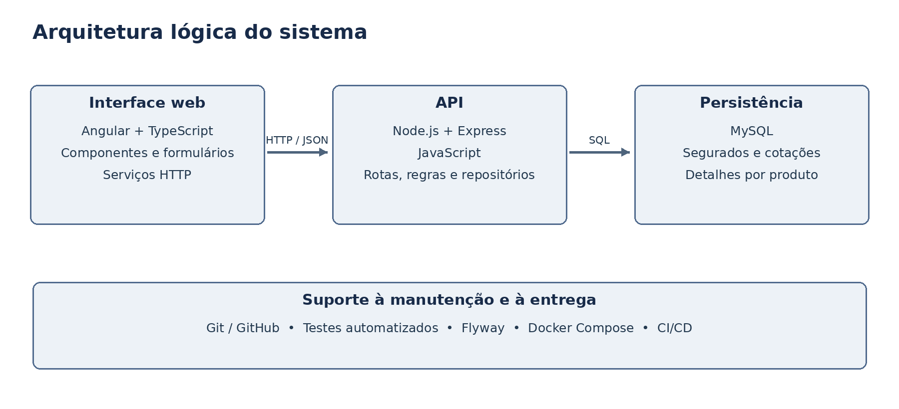

Fonte: elaboração do grupo a partir do código-fonte, 2026.

O diagrama representa a organização lógica identificada, sem indicar medição de desempenho ou disponibilidade. A separação entre camadas facilita alterações e substituição de dependências em testes, mas exige manter compatibilidade entre os modelos da interface, os contratos HTTP e as migrações.

### 3.3 Modelo de dados e consistência das cotações

A tabela customers reúne os dados do segurado. Cada registro em quotations referencia esse cadastro por customer_id e contém o produto, a data da solicitação, o estado ativo e campos de controle temporal. Os detalhes são armazenados em quotation_auto, quotation_home ou quotation_credit_card, vinculados pelo identificador da cotação.

**Figura 2 — Relacionamentos centrais do modelo de cotações**

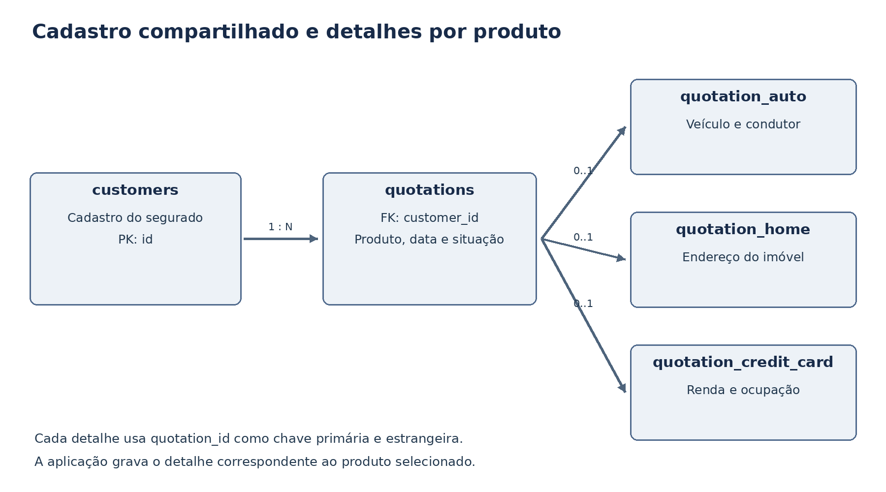

Fonte: elaboração do grupo a partir das migrações SQL, 2026.

Cada tabela de detalhes utiliza quotation_id como chave primária e estrangeira. A aplicação seleciona a tabela correspondente ao produto e grava os registros na mesma transação. A migração não estabelece, sozinha, uma restrição que assegure a existência de exatamente um detalhe entre as três tabelas; essa consistência também depende das regras de gravação da aplicação.

Os endpoints específicos filtram as consultas e alterações pelo produto da rota. Dessa forma, uma solicitação de automóvel não pode ser alterada por meio da API residencial. A API geral admite mudança de produto e substitui os detalhes dentro da transação. Quando ocorre remoção física, as chaves estrangeiras foram configuradas para remover os detalhes associados; pela API, a exclusão usual corresponde à desativação lógica.

A migração V9005 registra uma decisão relevante: apaga as cotações existentes antes de concluir a reorganização das colunas e dos detalhes. Portanto, a evolução de estrutura não representa uma conversão automática e preservadora do histórico anterior. O procedimento exige planejamento de dados e cópias de segurança. Essa decisão integra as limitações de migração da versão analisada.

#### 3.3.1 APIs e contratos de comunicação

A comunicação entre a interface Angular e o backend utiliza HTTP, com corpos e respostas em JSON. As rotas de negócio estão sob o prefixo `/v1`. O login é público; segurados, cotações, consulta de CEP, usuários e perfis exigem o cabeçalho `Authorization: Bearer <token>`. O middleware valida a assinatura e a expiração do JWT e retorna o código 401 quando o token está ausente ou é inválido. O cabeçalho opcional `Accept-Language` seleciona mensagens em português ou inglês; na ausência dele, a API utiliza português brasileiro.

O contrato adota `GET` para consulta, `POST` para criação, `PUT` para substituição dos dados editáveis, `DELETE` para desativação lógica e `PATCH` para alteração explícita da situação. As listas de segurados, cotações e usuários retornam um objeto no formato `{ data: [...], total: número }`, enquanto as rotas `/count` retornam `{ total: número }`. A criação bem-sucedida responde com 201 e o objeto criado; consultas e alterações bem-sucedidas respondem com 200. A API não implementa paginação na versão analisada, de modo que `total` na resposta de lista corresponde à quantidade de itens retornados.

**Quadro 4 — Endpoints e operações expostos pela API**

| Recurso | Endpoints | Operações e contrato principal |
| --- | --- | --- |
| Serviço | `GET /`, `GET /health`, `GET /health/db` | Identificação da API e verificação dos serviços; não exigem token |
| Autenticação | `POST /v1/auth/login` | Recebe `identifier` e `password`; devolve `token` e `user` |
| Segurados | `/v1/insureds` e `/v1/customers` | Aliases do mesmo recurso; `GET /count`, `GET /`, `GET /:id`, `POST /`, `PUT /:id`, `DELETE /:id`, `PATCH /:id/activate` e `PATCH /:id/deactivate` |
| Cotações gerais | `/v1/quotations` | `GET /count`, `GET /`, `GET /:id`, `POST /`, `PUT /:id`, `DELETE /:id` e `PATCH /:id/activate` |
| Cotações por produto | `/v1/quotations/auto`, `/home` e `/credit-card` | Mesmas operações de cotações, com produto fixado e conferido pela rota |
| CEP | `GET /v1/zip-codes/:zipCode` | Recebe oito dígitos, consulta o ViaCEP e devolve o endereço normalizado |
| Usuários | `/v1/users` | `GET /count`, `GET /`, `GET /:id`, `POST /`, `PUT /:id`, `DELETE /:id` e `PATCH /:id/activate` |
| Perfis de acesso | `/v1/roles` | `GET /`, `GET /:id`, `POST /`, `PUT /:id`, `DELETE /:id` e `PATCH /:id/activate` |

Fonte: backend/src/app.js e arquivos de rotas dos módulos, 2026.

Nas consultas, `active=0|1` filtra segurados, cotações, usuários e perfis. Cotações também aceitam `customer_id` e `product`; usuários aceitam `role_id`. Nas rotas específicas, o produto é determinado pelo caminho: `auto`, `home` ou `credit_card`, sendo este último representado no endereço por `credit-card`. Uma tentativa de enviar outro produto para uma rota específica retorna 400. A consulta ou alteração de um identificador por uma rota de modalidade diferente retorna 404, impedindo que os detalhes de um produto sejam tratados como se pertencessem a outro.

**Quadro 5 — Contratos de entrada dos principais recursos**

| Operação | Campos do corpo JSON | Regras verificadas no backend |
| --- | --- | --- |
| Login | `identifier`, `password` | Ambos obrigatórios; o identificador pode ser usuário ou e-mail |
| Segurado | `name`, `email`, `is_foreign`, `cpf` ou `rnm`, `birth_date`, `zip_code`, `street`, `number`, `complement`, `district`, `city`, `state`, `active` | CPF é exigido para brasileiro e RNM para estrangeiro; e-mail e endereço são validados; `complement` é opcional |
| Cotação comum | `customer_id`, `product`, `request_date`, `active` | Cliente deve existir; produto deve ser `auto`, `home` ou `credit_card` |
| Automóvel | Campos comuns, `insurance_type`, `bonus_class`, `has_claims`, `vehicle_plate`, `vehicle_chassis`, `vehicle_brand`, `vehicle_model`, `manufacture_year`, `overnight_zipcode`, `driver_age`, `license_time`, `coverages`, `has_insurer_preference`, `preferred_insurer` | Veículo e condutor são obrigatórios; renovação condiciona bônus e sinistro; seguradora é exigida quando há preferência |
| Residencial | Campos comuns, `insurance_type`, `has_claims`, `coverages`, `has_insurer_preference`, `preferred_insurer`, `property_zipcode`, `property_street`, `property_number`, `property_complement`, `property_district`, `property_city`, `property_state` | CEP do imóvel deve conter oito dígitos; unidade federativa e campos do endereço são validados |
| Cartão de crédito | Campos comuns, `monthly_income`, `occupation` | Renda deve ser positiva, com até duas casas decimais; ocupação é obrigatória |
| Usuário | `role_id`, `name`, `username`, `email`, `password`, `active` | Perfil deve existir e estar ativo; usuário aceita de 3 a 30 caracteres definidos; senha tem no mínimo oito caracteres e só é obrigatória na criação |
| Perfil de acesso | `name`, `active` | Nome obrigatório e único; desativação é impedida quando o perfil está em uso |

Fonte: validadores e serviços do backend e modelos do frontend, 2026.

No login bem-sucedido, a resposta contém `{ token, user }`. O objeto `user` reúne `id`, `role_id`, `role_name`, `name`, `username`, `email`, `active` e datas de controle. A senha e seu hash não são devolvidos. Os objetos de segurado incluem o identificador, os campos cadastrais normalizados e as datas de criação e alteração. As respostas de cotação reúnem `id`, dados comuns, campos da modalidade, `customer_name`, `customer_cpf` e `customer_email`; `coverages` é devolvido como lista. Usuários e perfis seguem os campos de seus contratos, sem exposição do hash de senha.

**Quadro 6 — Respostas e erros do contrato HTTP**

| Código | Formato observado | Aplicação |
| --- | --- | --- |
| 200 | Objeto do recurso, lista com `data` e `total`, contagem ou `{ message }` | Consulta, atualização, ativação e desativação bem-sucedidas |
| 201 | Objeto criado | Cadastro de segurado, cotação, usuário ou perfil |
| 400 | `{ message, errors: [...] }` | Corpo inválido, duplicidade, cliente ou perfil inválido e regra de negócio não atendida |
| 401 | `{ message }` | Credenciais inválidas, token ausente, expirado ou inválido |
| 404 | `{ message }` | Recurso, CEP ou cotação da modalidade não encontrado |
| 500 | `{ message, detail }` | Falha interna nas rotas de domínio |
| 502 | `{ message }` | Indisponibilidade ou falha na consulta externa de CEP |

Fonte: backend/src/utils/http.js, middlewares e manipuladores das rotas, 2026.

Os contratos mostram duas decisões de integração relevantes. Primeiro, o frontend mantém modelos com nomes em português e os serviços convertem esses campos para os nomes em inglês usados pela API. Segundo, booleanos são transportados como `0` e `1` nas respostas persistidas, embora os validadores também aceitem valores booleanos e suas representações textuais. Essa conversão fica concentrada nos serviços do frontend e nos validadores do backend, reduzindo o acoplamento dos componentes visuais ao formato do banco.

Não foi localizado um documento OpenAPI ou JSON Schema gerado junto ao código. Assim, os contratos deste trabalho foram extraídos das rotas, dos validadores, dos serviços, dos modelos do frontend e dos testes automatizados. Eles descrevem a versão analisada e devem ser mantidos em conjunto com o software; uma evolução recomendada é formalizá-los em OpenAPI, acrescentando exemplos executáveis, versionamento e verificação automática de compatibilidade.

### 3.4 Fluxo de navegação e acesso

O acesso à aplicação ocorre pela tela de login, com usuário ou e-mail e senha. Após autenticação, o usuário chega ao painel, que apresenta contagens de clientes, cotações e usuários, além de atalhos para as respectivas listas. O menu lateral oferece acesso ao painel, aos clientes, às cotações e à manutenção de usuários, além do encerramento da sessão, com adaptação de abertura em telas menores.

A criação de uma solicitação parte do cadastro do cliente. O identificador do segurado é transportado para o formulário, evitando preencher novamente seus dados pessoais. O usuário seleciona o produto, preenche os campos correspondentes e envia as informações para validação e gravação.

**Figura 3 — Fluxo principal de atendimento no sistema**

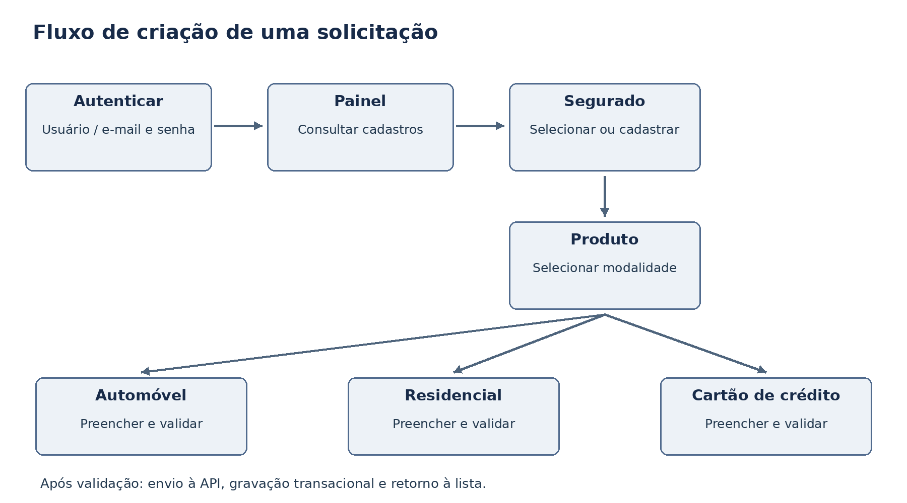

Fonte: elaboração do grupo a partir das rotas e dos componentes, 2026.

**Quadro 7 — Principais rotas da interface**

| Rota | Finalidade | Comportamento verificado |
| --- | --- | --- |
| /login | Autenticação | Recebe credenciais e encaminha ao painel |
| /painel | Visão geral | Consulta contagens e apresenta atalhos |
| /clientes e /clientes/novo | Gestão de segurados | Lista e formulário de cadastro |
| /clientes/:id | Alteração do segurado | Carrega e envia dados para atualização |
| /cotacoes | Gestão de solicitações | Lista registros e permite manutenção |
| /cotacoes/nova/:clienteId | Nova solicitação | Associa o cliente e apresenta seleção de produto |
| /cotacoes/:id | Edição de solicitação | Carrega dados comuns e específicos |
| /usuarios | Gestão de usuários | Cadastro e manutenção de usuários |

Fonte: frontend/src/app/app.routes.ts e componentes relacionados, 2026.

As Figuras 4 e 5 mostram a autenticação e o painel do aplicativo executado a partir do repositório. Os números exibidos no painel correspondem aos registros fictícios do ambiente temporário utilizado nas capturas.

**Figura 4 — Tela de autenticação do aplicativo**

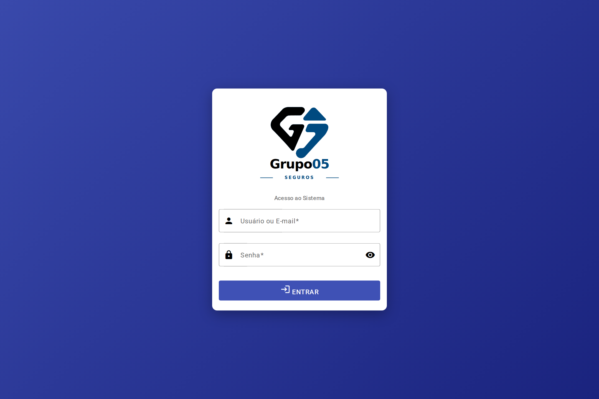

Fonte: captura do aplicativo do repositório em execução local, com dados fictícios, 2026.

**Figura 5 — Painel com contagens e atalhos**

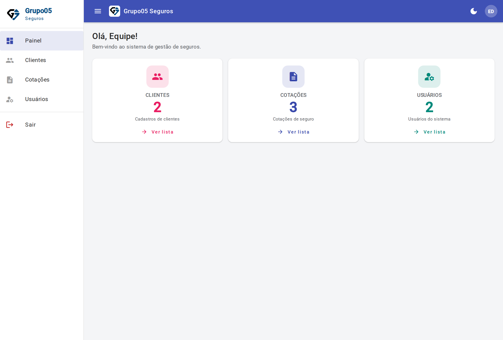

Fonte: captura do aplicativo do repositório em execução local, com dados fictícios, 2026.

### 3.5 Gestão de segurados e apoio ao preenchimento

O cadastro de segurados contém nome, e-mail, data de nascimento, identificação e endereço. A implementação contempla CPF ou Registro Nacional Migratório conforme a condição informada. Campos obrigatórios, limites de tamanho e verificações de duplicidade contribuem para a consistência dos registros.

A consulta de CEP é feita por uma rota autenticada da API, que utiliza o serviço ViaCEP para obter informações de endereço. A rotina trata formato inválido, ausência de resultado e falha de consulta. O preenchimento depende da disponibilidade do serviço externo e precisa ser conferido pelo usuário, especialmente no que se refere a número e complemento.

O cadastro compartilhado evita repetir as informações pessoais em cada produto. Para seguro residencial, o endereço do segurado é utilizado como referência inicial, mas o endereço do imóvel permanece editável. A cotação preserva seus próprios dados de localização do imóvel, permitindo representar uma residência diferente daquela informada no cadastro pessoal.

As Figuras 6 e 7 apresentam a lista de clientes e o formulário de edição de um cadastro demonstrativo. A organização observada corresponde aos componentes atuais do repositório.

**Figura 6 — Lista de clientes e acesso à nova cotação**

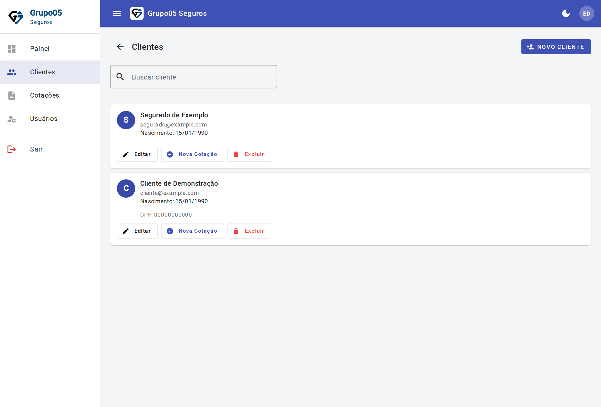

Fonte: captura do aplicativo do repositório em execução local, com dados fictícios, 2026.

**Figura 7 — Formulário de dados pessoais e endereço do cliente**

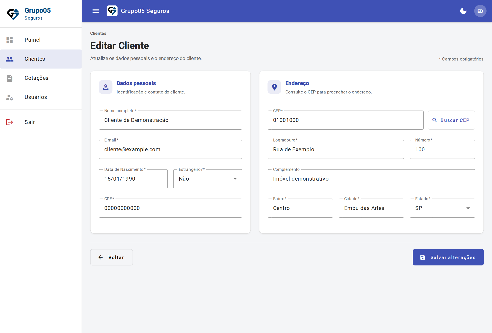

Fonte: captura do aplicativo do repositório em execução local, com dados fictícios, 2026.

### 3.6 Solicitações por produto

#### 3.6.1 Automóvel

O formulário de automóvel reúne tipo de seguro, identificação do veículo, informações do condutor, CEP de pernoite e preferências de cobertura ou seguradora. O tipo renovação condiciona campos adicionais, como informações de sinistro e classe de bônus. A seleção de preferência de seguradora também altera a necessidade de preenchimento correspondente.

As validações da interface organizam o preenchimento e as validações da API verificam os dados novamente. Essa duplicação de finalidade é necessária porque chamadas ao servidor podem ser realizadas sem passar pelo formulário. A solução organiza os dados para solicitação; não realiza precificação automática do seguro.

**Figura 8 — Formulário de cotação de automóvel**

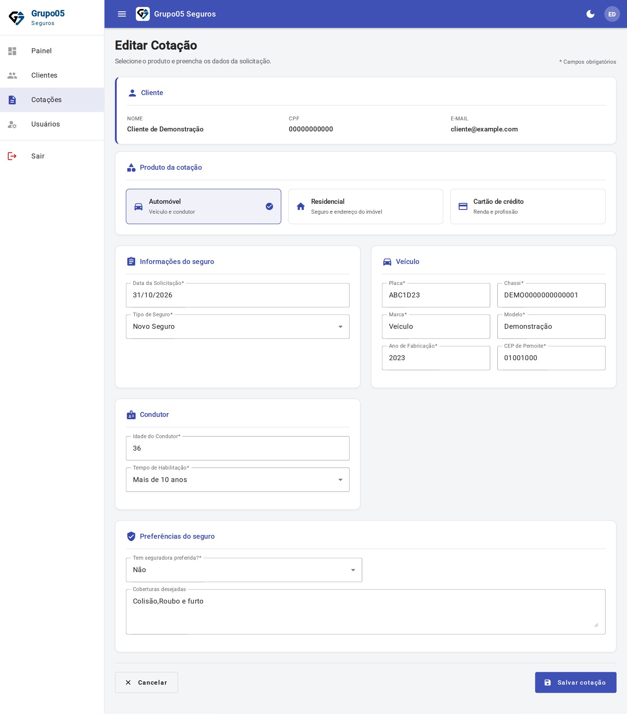

Fonte: captura do aplicativo do repositório em execução local, com dados fictícios, 2026.

#### 3.6.2 Residencial

O produto residencial utiliza informações do seguro e endereço do imóvel, com campos de CEP, logradouro, número, complemento, bairro, cidade e unidade federativa. As validações não exigem informações de veículo ou condutor. Na renovação, a informação de sinistro é tratada conforme a regra do produto, sem exigir classe de bônus automotiva.

Essa separação representa uma evolução concreta sobre a utilização de um formulário único de automóvel. Os dados particulares do imóvel são armazenados em sua tabela de detalhes e permanecem vinculados ao mesmo cadastro de segurado utilizado nas demais modalidades.

**Figura 9 — Formulário de cotação de seguro residencial**

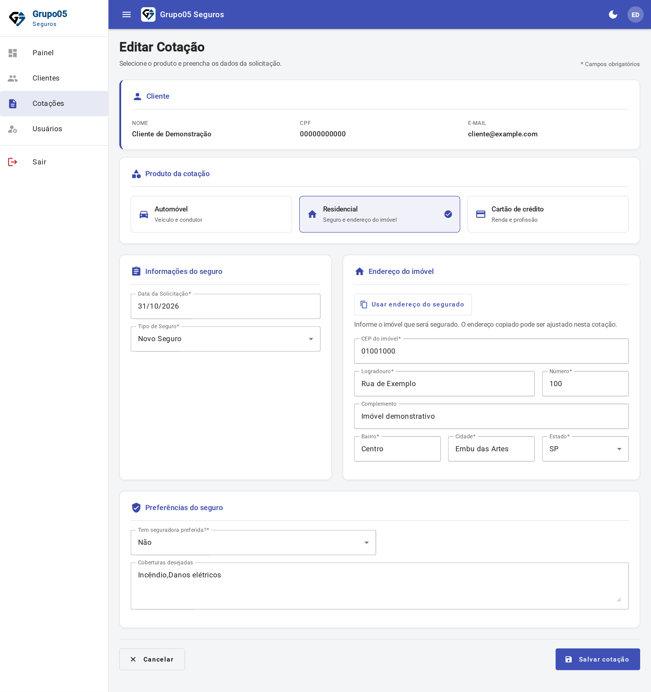

Fonte: captura do aplicativo do repositório em execução local, com dados fictícios, 2026.

#### 3.6.3 Cartão de crédito

O módulo de cartão de crédito registra renda mensal e ocupação, além dos dados comuns da solicitação e do vínculo com o segurado. A renda deve ser positiva e respeitar os limites e a precisão decimal previstos, enquanto a ocupação deve conter texto válido.

A implementação descarta os dados específicos de outras modalidades ao normalizar a solicitação de cartão. Isso evita exigir ou persistir campos de veículo e imóvel sem relação com o produto. O resultado é um registro estruturado de solicitação, sujeito à análise posterior do fornecedor responsável.

**Figura 10 — Formulário de solicitação de cartão de crédito**

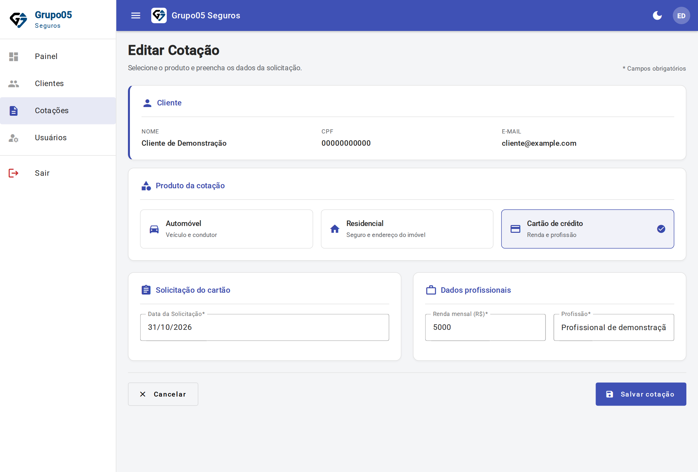

Fonte: captura do aplicativo do repositório em execução local, com dados fictícios, 2026.

**Quadro 8 — Dados comuns e particularidades dos produtos**

| Grupo | Dados principais | Regra relevante |
| --- | --- | --- |
| Comum | Segurado, produto, data e situação | Cadastro referenciado pela cotação |
| Automóvel | Veículo, condutor, pernoite e seguro | Condições adicionais para renovação e preferências |
| Residencial | Endereço do imóvel e informações do seguro | Não exige veículo nem condutor |
| Cartão de crédito | Renda e ocupação | Renda positiva e sem campos de seguro automotivo |

Fonte: validadores, componentes e migrações da aplicação, 2026.

A lista de cotações reúne as três modalidades e apresenta informações compatíveis com o produto, como veículo, endereço do imóvel ou renda e profissão. A Figura 11 mostra os três registros fictícios utilizados na demonstração.

**Figura 11 — Lista integrada de cotações dos três produtos**

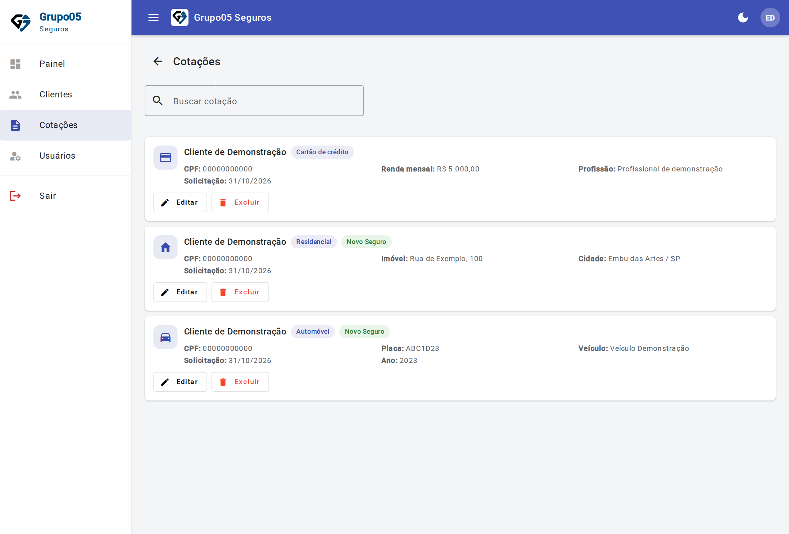

Fonte: captura do aplicativo do repositório em execução local, com dados fictícios, 2026.

### 3.7 Interface e recursos de acessibilidade

A modernização da interface utiliza menu lateral, cartões de informação, componentes de formulário, mensagens de validação e confirmações de ação. O sistema oferece temas claro e escuro com armazenamento da preferência no navegador. Os componentes de layout observam dimensões de tela e ajustam o comportamento do menu para dispositivos menores.

Foram identificados rótulos em controles, atributos de identificação semântica, ícones decorativos marcados para serem ignorados por leitores de tela e estado de seleção nos botões de produto. O seletor de modalidade também possui estilização de foco visível. Esses recursos constituem evidências de implementação que precisam ser avaliadas no conjunto do processo de uso.

Todas as telas apresentadas nesta seção foram capturadas na execução local do aplicativo do repositório. A Figura 12 mostra o tema escuro aplicado ao mesmo painel ilustrado na Figura 5, após a alternância pelo controle da própria interface.

As Figuras 4 a 14 apresentam a versão desktop. O Apêndice C reúne as versões mobile das mesmas funcionalidades e o menu expandido, com a correspondência entre as figuras. Na largura móvel utilizada, o menu passa a ser recolhido e sobreposto ao conteúdo quando aberto, enquanto cartões e campos se reorganizam verticalmente. As vistas sequenciais dos formulários mostram a continuidade do conteúdo durante a rolagem. A observação se limita à configuração registrada e não demonstra compatibilidade com todos os dispositivos e resoluções.

**Figura 12 — Painel do aplicativo com o tema escuro**

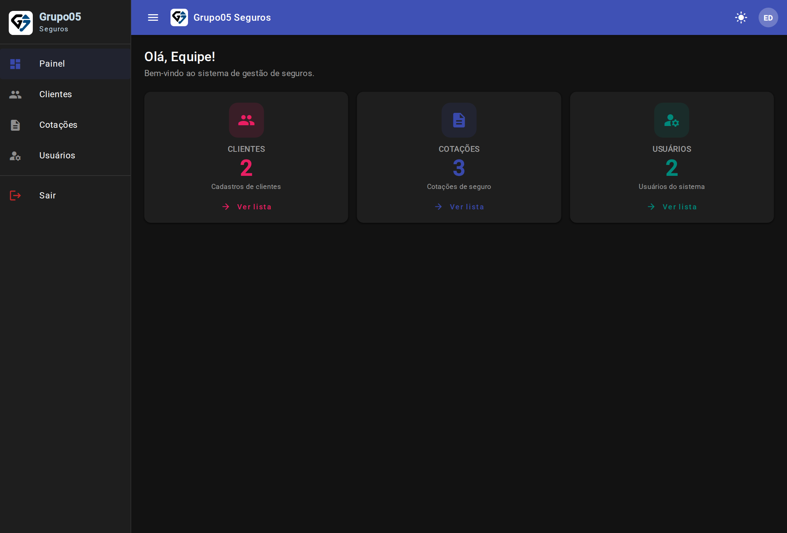

Fonte: captura do aplicativo do repositório em execução local, com dados fictícios, 2026.

As telas de gestão de usuários utilizam a lista e o formulário apresentados nas Figuras 13 e 14. A existência dessas telas e do campo de perfil deve ser distinguida da aplicação de permissões na API, discutida na seção de segurança.

**Figura 13 — Lista de usuários do sistema**

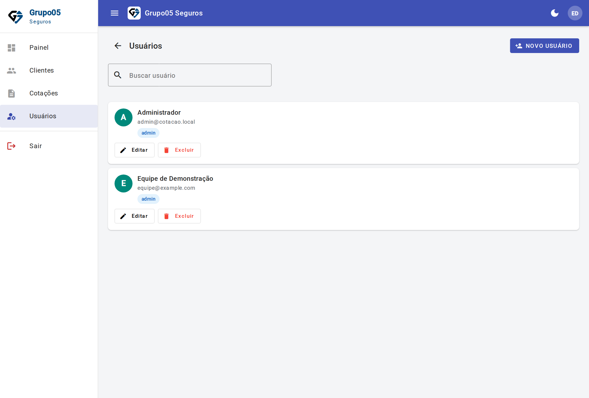

Fonte: captura do aplicativo do repositório em execução local, com dados fictícios, 2026.

**Figura 14 — Formulário de cadastro de usuário**

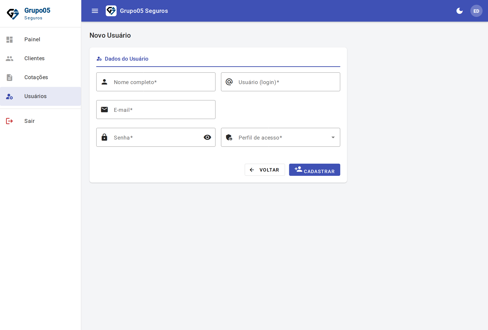

Fonte: captura do aplicativo do repositório em execução local, com dados fictícios, 2026.

**Quadro 9 — Recursos de acessibilidade e verificação necessária**

| Aspecto | Evidência na implementação | Verificação complementar |
| --- | --- | --- |
| Identificação dos controles | Rótulos e aria-label em controles específicos | Confirmar nomes acessíveis em todas as telas |
| Agrupamento dos campos | Seções com aria-labelledby | Avaliar compreensão com leitor de tela |
| Seleção de produto | Botões com aria-pressed | Verificar anúncio de estado e operação por teclado |
| Foco | Estilo focus-visible no seletor de produto | Percorrer o fluxo completo e observar ordem e visibilidade |
| Tema | Alternância entre claro e escuro | Medir contraste de textos, controles e mensagens |
| Responsividade | Menu adaptado e estilos de layout | Testar zoom, largura reduzida e ausência de perda de conteúdo |
| Erros e carregamento | Mensagens de campo e identificação de carregamento | Avaliar anúncio e recuperação após erro |

Fonte: templates e estilos do frontend, 2026; critérios orientados por W3C (2025).

A existência de tema escuro não permite concluir que o contraste seja adequado em todos os componentes nem que a experiência seja preferível para todas as pessoas com baixa visão. A escolha de tema oferece personalização. A comprovação de acessibilidade depende da avaliação dos critérios aplicáveis, dos dois temas e dos processos completos.

### 3.8 Segurança e controle de acesso

A autenticação verifica as credenciais, rejeita usuário inativo e gera token JWT com prazo de validade configurável. As rotas de segurados, cotações, usuários, perfis e CEP exigem token por meio de middleware. As senhas são armazenadas como hashes Argon2id, com parâmetros explicitados no utilitário responsável.

O cadastro de perfis e a inclusão de informações de perfil no token estão presentes. Entretanto, o middleware examinado valida o token sem aplicar uma regra geral de permissão por ação ou domínio. As rotas administrativas de usuários e perfis também não apresentam um controle adicional de autorização. Assim, a restrição administrativa descrita como objetivo permanece incompleta e não deve ser apresentada como resultado integralmente alcançado.

O token é armazenado no localStorage e removido pelo logout do frontend. Esse mecanismo de saída não revoga, por si só, um token já emitido no servidor. A camada examinada também não consulta o estado atualizado do usuário a cada requisição autenticada. Esses aspectos delimitam as garantias de sessão da versão atual e orientam melhorias posteriores.

As configurações de produção incluem proxy HTTPS e isolamento dos serviços internos. O código, contudo, ainda possui valor alternativo de segredo JWT para desenvolvimento e configuração ampla de CORS. A disponibilidade desses mecanismos não autoriza concluir que toda a aplicação esteja protegida ou em conformidade integral com exigências legais. A revisão deve tratar cada controle e seu contexto de operação.

### 3.9 Ambientes, publicação e manutenção

O repositório organiza configurações para desenvolvimento, homologação e produção, com bancos e volumes separados. O Docker Compose descreve frontend, API, MySQL e ferramentas de apoio, enquanto arquivos próprios adaptam a execução de produção.

A documentação atual identifica a Oracle Cloud Infrastructure como infraestrutura de implantação. O frontend é servido por Nginx e o Caddy realiza o acesso HTTPS e o encaminhamento das requisições à API. A referência de endereço é cotacao.grupo05.com.br. A configuração e a documentação foram verificadas, mas a disponibilidade pública do endereço e o histórico de execução do deploy não foram confirmados nesta análise.

O fluxo de integração contínua está configurado para instalar dependências, executar testes de backend e frontend e compilar a interface. O fluxo de publicação depende de sucesso do CI em um envio à branch master, gera imagens e encaminha uma release ao servidor. O procedimento inclui cópia de segurança antes das migrações e verificação de saúde após a atualização.

Esse arranjo contribui para a repetição e a rastreabilidade das entregas. Ainda assim, a descrição de produção informa interrupção breve durante recriação de serviços e ausência de reversão automática do banco. Não foram realizados testes de carga, recuperação de desastre ou medição de disponibilidade para sustentar garantias adicionais.

### 3.10 Verificação por testes automatizados

A execução do comando npm run test:cov na cópia temporária da versão analisada apresentou 201 testes aprovados, nenhuma falha, nenhum cancelamento e nenhum teste ignorado. O resultado foi registrado em 31 de outubro de 2026, preservando o log para rastreabilidade.

**Tabela 1 — Resultado da execução dos testes de backend**

| Indicador | Resultado |
| --- | --- |
| Versão analisada | b3a12b3 — 31/10/2026 |
| Ambiente local de verificação | Node.js 18.19.1; cópia temporária |
| Comando | npm run test:cov |
| Testes executados | 201 |
| Testes aprovados | 201 |
| Falhas | 0 |
| Cancelados e ignorados | 0 |
| Banco de produção acessado | Não |

Fonte: log da execução técnica preservado junto a esta minuta, 2026.

Os casos abrangem credenciais inválidas, usuário inativo, ausência ou invalidez de token, validações de cadastros, operações de usuários e perfis e regras de cotações. Há testes específicos para o endereço residencial, a renda e a ocupação no cartão, produtos desconhecidos e a tentativa de acessar ou alterar uma cotação pela API de outra modalidade.

Os testes de rotas utilizam servidor HTTP local e substituição de serviços; os testes de serviços empregam dependências controladas. Portanto, o conjunto demonstra comportamentos dessas camadas, mas não equivale a uma validação completa das consultas e transações em um MySQL real. Essa distinção é relevante para interpretar o alcance do resultado.

O comando também gera um relatório de cobertura que agrega arquivos de teste e código da aplicação. Por esse motivo, seu percentual global não é utilizado como medida isolada da cobertura do produto. Uma avaliação mais precisa deve delimitar os arquivos de produção e acrescentar testes de integração de persistência.

O frontend possui arquivos de testes e configuração de execução em navegador no CI, mas essa suíte não foi executada na presente verificação. Não foram transferidos para a versão atual percentuais históricos de cobertura apresentados em registros visuais anteriores.

### 3.11 Atendimento dos objetivos

**Quadro 10 — Síntese de atendimento dos objetivos específicos**

| Objetivo | Resultado demonstrado | Situação |
| --- | --- | --- |
| Reorganizar automóvel | Campos condicionais e validação no formulário e na API | Implementado tecnicamente |
| Incluir residencial e cartão | Rotas, regras e detalhes de dados por modalidade | Implementado tecnicamente |
| Melhorar organização técnica | Componentes, serviços, validadores e repositórios | Implementado |
| Incorporar acessibilidade | Semântica, identificação, foco e temas | Parcial; avaliação integral pendente |
| Fortalecer segurança | JWT, Argon2id e validação de entrada | Parcial; autorização e sessão requerem evolução |
| Estruturar ambientes e entrega | Compose, Flyway e workflows | Configurado; operação de produção não auditada |
| Avaliar solução | 201 testes de backend aprovados e roteiro de campo elaborado | Parcial; validação atual com usuários pendente |

Fonte: elaboração do grupo a partir das evidências analisadas, 2026.

O objetivo geral foi alcançado quanto à ampliação dos produtos e à reorganização técnica comprovada. As dimensões de acessibilidade, autorização e avaliação de impacto ainda apresentam requisitos a concluir. Essa leitura permite reconhecer a entrega funcional sem confundir mecanismos presentes com garantias abrangentes de qualidade.

### 3.12 Limitações e avaliação do impacto

A autorização por perfil exige regras explícitas e testes de acesso permitido e negado para cada operação. A verificação de acessibilidade necessita percurso completo com teclado, leitores de tela, contraste e ampliação. A persistência requer testes com banco real, sobretudo para reversão de transações, mudança de produto e execução das migrações.

Não foram fornecidos dados comparáveis de tempo de atendimento, custos, conversão de solicitações em contratos ou satisfação medidos antes e depois da evolução. Assim, a redução de retrabalho e a melhoria de atendimento são benefícios esperados da organização implementada. O presente estudo não atribui valores percentuais nem estabelece relação causal entre a mudança tecnológica e resultados comerciais.

**Quadro 11 — Indicadores propostos para avaliação em campo**

| Indicador | Forma de obtenção | Situação |
| --- | --- | --- |
| Conclusão de tarefas | Tarefas concluídas divididas pelas tentativas | Coleta pendente |
| Tempo de preenchimento | Mediana por produto e cenário | Coleta pendente |
| Erros de preenchimento | Registros rejeitados e correções necessárias | Coleta pendente |
| Reutilização cadastral | Solicitações vinculadas a clientes já existentes | Coleta pendente |
| Satisfação | Questionário breve após tarefas e comentários | Coleta pendente |
| Atendimento acessível | Critérios avaliados e barreiras por fluxo | Coleta pendente |

Fonte: proposta de avaliação do grupo, 2026.

A adoção desses indicadores deve utilizar cenários equivalentes, registrar condições de aplicação e preservar a identificação dos participantes. Uma amostra pequena de conveniência pode orientar ajustes, mas não sustenta generalizações para todo o mercado de corretoras.

## 4 CONSIDERAÇÕES FINAIS

O Projeto Integrador II consolidou a evolução do sistema de cotação do Grupo05 Seguros a partir da solução apresentada no PI I. A ampliação para seguro residencial e cartão de crédito passou a contar com seleção de produto, formulários condicionais, validações específicas e estruturas próprias de persistência, compartilhando o cadastro do segurado. Esse conjunto responde à necessidade de organizar solicitações de diferentes modalidades em uma mesma aplicação.

A modernização tecnológica organizou a interface em Angular e TypeScript e os serviços em uma API Node.js/Express escrita em JavaScript, mantendo MySQL na persistência. A utilização de transações, migrações, containers e fluxos de automação fornece uma base mais explícita para manutenção e entrega. A aprovação de 201 testes de backend constitui evidência verificável dos comportamentos cobertos pela suíte na versão analisada.

Os recursos de interface incluem reorganização dos formulários, componentes padronizados, temas e identificação semântica de controles. Entretanto, a conformidade integral de acessibilidade não foi demonstrada. Na segurança, autenticação e hashing estão implementados, enquanto autorização por perfil e aspectos de sessão requerem complementação.

A contribuição acadêmica está na articulação entre análise de necessidades, desenvolvimento web, modelagem de dados, segurança, interação humano-computador e verificação de software. A comparação com o PI I demonstra mudanças concretas de escopo e organização, e a identificação das limitações permite definir prioridades de continuidade de forma fundamentada.

Para os próximos aperfeiçoamentos, destacam-se as regras de autorização, os testes de persistência e migração e a avaliação de acessibilidade e usabilidade com usuários. A integração com fornecedores deve ser tratada como uma expansão específica, com requisitos e avaliação próprios. A demonstração de ganhos operacionais depende da coleta dos indicadores propostos, de modo que os benefícios esperados possam ser confrontados com resultados observados na comunidade externa.

## REFERÊNCIAS

ANGULAR. Anatomy of components. [S.l.], s.d. Disponível em: https://angular.dev/guide/components. Acesso em: 31 out. 2026.

CHACON, Scott; STRAUB, Ben. Pro Git. 2. ed. New York: Apress, 2014. Disponível em: https://git-scm.com/book/en/v2/Getting-Started-About-Version-Control. Acesso em: 31 out. 2026.

DOCKER. Why use Compose? [S.l.], s.d. Disponível em: https://docs.docker.com/compose/intro/features-uses/. Acesso em: 31 out. 2026.

EXPRESS. Routing. [S.l.], s.d. Disponível em: https://expressjs.com/en/guide/routing/. Acesso em: 31 out. 2026.

GITHUB. Understanding GitHub Actions. [S.l.], s.d. Disponível em: https://docs.github.com/en/actions/get-started/understand-github-actions. Acesso em: 31 out. 2026.

GRUPO05 SEGUROS. Sistema de cotação: código-fonte e documentação técnica. Versão local do repositório cotacao, commit b3a12b3, de 31 out. 2026. Inclui README, módulos da aplicação, migrações, testes e configuração de publicação. Material técnico analisado em: 31 out. 2026.

IDEO.ORG. Design Kit: Methods. [S.l.], s.d. Disponível em: https://www.designkit.org/methods.html. Acesso em: 31 out. 2026.

NODE.JS. Overview of Blocking vs Non-Blocking. [S.l.], s.d. Disponível em: https://nodejs.org/learn/asynchronous-work/overview-of-blocking-vs-non-blocking. Acesso em: 31 out. 2026.

ORACLE. MySQL 8.4 Reference Manual: START TRANSACTION, COMMIT, and ROLLBACK Statements. [S.l.], s.d. Disponível em: https://dev.mysql.com/doc/refman/8.4/en/commit.html. Acesso em: 31 out. 2026.

OWASP. Authorization Cheat Sheet. [S.l.], s.d.a. Disponível em: https://cheatsheetseries.owasp.org/cheatsheets/Authorization_Cheat_Sheet.html. Acesso em: 31 out. 2026.

OWASP. Password Storage Cheat Sheet. [S.l.], s.d.b. Disponível em: https://cheatsheetseries.owasp.org/cheatsheets/Password_Storage_Cheat_Sheet.html. Acesso em: 31 out. 2026.

REDGATE. Migrations. Flyway documentation. Atualizado em: 17 set. 2025. Disponível em: https://documentation.red-gate.com/fd/migrations-271585107.html. Acesso em: 31 out. 2026.

SOUZA, Fabio Cordeiro de. Otimização do Cadastro de Clientes na Cotação de Seguro de Automóvel. Relatório técnico-científico — Bacharelado em Tecnologia da Informação, Universidade Virtual do Estado de São Paulo, Embu das Artes, 2025.

SOUZA, Fabio Cordeiro de; LIMA, Ramilton Silva. Evolução do Sistema do Grupo05 Seguros com Novos Produtos e Acessibilidade. Relatório parcial — Projeto Integrador II, Bacharelado em Tecnologia da Informação, Universidade Virtual do Estado de São Paulo, Embu das Artes, 2025.

W3C. Accessible Rich Internet Applications (WAI-ARIA) 1.2. Recomendação de 6 jun. 2023. Disponível em: https://www.w3.org/TR/wai-aria-1.2/. Acesso em: 31 out. 2026.

W3C. Web Content Accessibility Guidelines (WCAG) 2.1. Recomendação de 6 maio 2025. Disponível em: https://www.w3.org/TR/WCAG21/. Acesso em: 31 out. 2026.

## APÊNDICE A — ROTEIRO DE AVALIAÇÃO COM A COMUNIDADE EXTERNA

Este instrumento foi elaborado para a validação da versão consolidada. Sua apresentação não indica que a sessão tenha sido realizada. Recomenda-se utilizar ambiente de homologação, dados fictícios e identificação codificada dos participantes.

**Quadro A1 — Tarefas propostas para validação**

| Tarefa | Ação solicitada | Critério observado |
| --- | --- | --- |
| T1 | Entrar com credenciais de teste | Autenticação e compreensão do retorno |
| T2 | Cadastrar um segurado e consultar o CEP | Conclusão, erros e conferência do endereço |
| T3 | Criar solicitação de automóvel | Compreensão dos campos e das condições de renovação |
| T4 | Criar residencial para o mesmo segurado | Reutilização cadastral e edição do endereço do imóvel |
| T5 | Registrar interesse em cartão de crédito | Preenchimento de renda e ocupação |
| T6 | Localizar, editar e desativar uma solicitação | Consistência da consulta e da alteração; reativação pela API em teste técnico complementar |
| T7 | Percorrer um formulário por teclado | Ordem de foco e operação dos controles |
| T8 | Alternar tema e utilizar tela reduzida | Legibilidade e preservação do conteúdo |
| T9 | Encerrar o acesso | Compreensão do logout e das limitações de sessão |

Fonte: elaboração do grupo, 2026.

Para cada tarefa, registrar código do participante, data, ambiente, produto, horário de início e término, conclusão com ou sem ajuda, erros, dúvidas e comentários. O observador deve distinguir falhas do software de dificuldades de compreensão e registrar a alteração proposta para cada barreira identificada.

Após as tarefas, perguntar: quais informações foram difíceis de encontrar; quais campos pareceram desnecessários; quais mensagens ajudaram ou atrapalharam; e qual mudança teria maior valor no atendimento cotidiano. A síntese deve apresentar evidências favoráveis e desfavoráveis, além das limitações da amostra.

## APÊNDICE B — MATRIZ DE RASTREABILIDADE TÉCNICA

**Quadro B1 — Relação entre afirmações e artefatos verificáveis**

| Afirmação | Artefato no repositório | Alcance da evidência |
| --- | --- | --- |
| Interface Angular/TypeScript | frontend/package.json; frontend/src/app/app.routes.ts | Tecnologia declarada e rotas implementadas |
| Backend JavaScript/Express | backend/package.json; backend/src/app.js | Dependências e montagem da API |
| Contratos HTTP | backend/src/app.js; backend/src/modules/*/*.routes.js; validadores e serviços HTTP do frontend | Endpoints, autenticação, entradas, respostas e erros da versão analisada |
| Três produtos | backend/src/modules/quotations/quotation-products.js | Definição dos campos por produto |
| Validação por modalidade | backend/src/modules/quotations/quotations.validator.js | Normalização e regras de entrada |
| Formulário condicional | frontend/src/app/components/cotacoes/form-cotacao/ | Campos, seleção e validações da interface |
| Modelo relacional | database/migrations/common/V9005__split_quotation_product_tables.sql | Detalhes por produto e reinicialização de cotações |
| Transações | backend/src/modules/quotations/quotations.repository.js | Gravação, confirmação e reversão previstas no código |
| Autenticação | backend/src/modules/auth/auth.service.js; backend/src/middlewares/auth.js | Emissão e verificação de JWT |
| Hash de senha | backend/src/utils/passwordHasher.js | Argon2id e parâmetros |
| Temas e responsividade | frontend/src/app/core/services/tema.service.ts; frontend/src/app/layout/shell/ | Preferência de tema e comportamento do menu |
| Testes de produtos | backend/test/quotation-products.test.js; backend/test/quotation-product-apis.test.js | Regras e isolamento das APIs por modalidade |
| Integração contínua | .github/workflows/build-and-test.yml | Testes e compilação configurados |
| Publicação | .github/workflows/prod-deploy.yml; docs/deploy-oci.md | Procedimento e infraestrutura documentados |

Fonte: inspeção do commit b3a12b3, 2026.

## APÊNDICE C — TELAS RESPONSIVAS: VERSÕES DESKTOP E MOBILE

As telas desktop da solução estão apresentadas nas Figuras 4 a 14, junto à descrição de cada funcionalidade. Este apêndice reúne as versões mobile correspondentes, capturadas no mesmo aplicativo e com os mesmos dados fictícios. A janela desktop utilizada possui 1440 pixels de largura; a configuração mobile utiliza 390 × 844 pixels CSS, com emulação de toque no navegador. As imagens mostram a renderização real dos componentes do repositório, sem redesenho ou alteração dos estilos.

Nos formulários que excedem a altura da tela, as capturas apresentam posições sucessivas da rolagem. A leitura segue da esquerda para a direita e continua na página seguinte quando necessário. A barra superior permanece visível, enquanto o conteúdo principal é rolado. O menu móvel foi registrado tanto recolhido quanto expandido. Essa demonstração não substitui a avaliação em dispositivos físicos e em outras resoluções.

**Quadro C1 — Correspondência entre as telas desktop e mobile**

| Funcionalidade | Desktop | Mobile |
| --- | --- | --- |
| Tela de autenticação | Figura 4 | Figura 15 |
| Painel com menu recolhido | Figura 5 | Figura 16 |
| Menu lateral expandido | Figura 5 | Figura 17 |
| Lista de clientes | Figura 6 | Figura 18 |
| Dados pessoais e endereço do cliente | Figura 7 | Figura 19 |
| Lista integrada de cotações | Figura 11 | Figura 20 |
| Cotação de automóvel | Figura 8 | Figura 21 |
| Cotação de seguro residencial | Figura 9 | Figura 22 |
| Solicitação de cartão de crédito | Figura 10 | Figura 23 |
| Lista de usuários | Figura 13 | Figura 24 |
| Cadastro de usuário | Figura 14 | Figura 25 |
| Painel com tema escuro | Figura 12 | Figura 26 |

Fonte: capturas do aplicativo do repositório em execução local, 2026.

Correspondência com a versão desktop: Figura 4. Vista da interface em tela móvel.

**Figura 15 — Tela de autenticação na versão mobile**

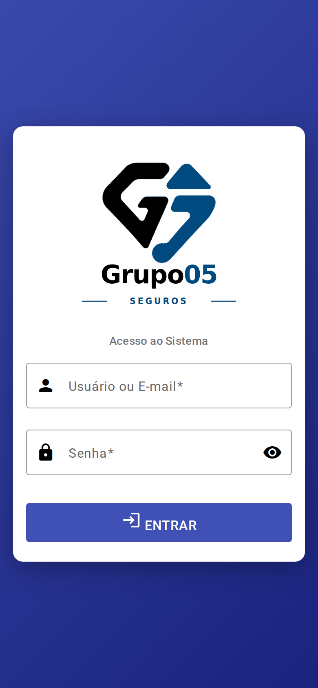

Fonte: captura do aplicativo do repositório, emulação mobile de 390 × 844 pixels CSS, dados fictícios, 2026.

Correspondência com a versão desktop: Figura 5. Vista da interface em tela móvel.

**Figura 16 — Painel com menu recolhido na versão mobile**

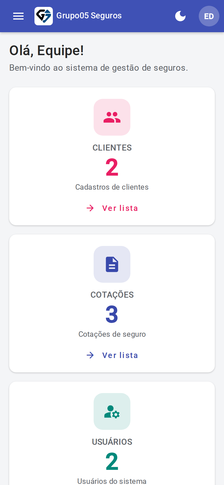

Fonte: captura do aplicativo do repositório, emulação mobile de 390 × 844 pixels CSS, dados fictícios, 2026.

Correspondência com a versão desktop: Figura 5. Vista da interface em tela móvel.

**Figura 17 — Menu lateral expandido na versão mobile**

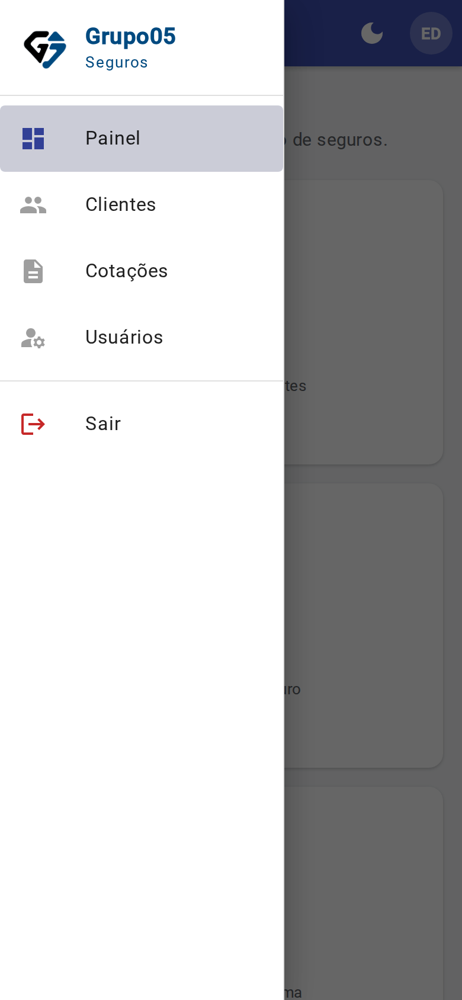

Fonte: captura do aplicativo do repositório, emulação mobile de 390 × 844 pixels CSS, dados fictícios, 2026.

Correspondência com a versão desktop: Figura 6. Vista da interface em tela móvel.

**Figura 18 — Lista de clientes na versão mobile**

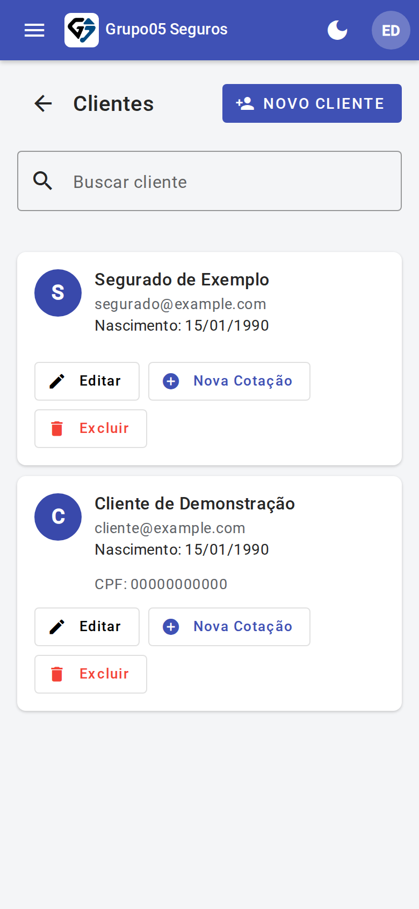

Fonte: captura do aplicativo do repositório, emulação mobile de 390 × 844 pixels CSS, dados fictícios, 2026.

Correspondência com a versão desktop: Figura 7. Vistas sequenciais de rolagem: 3.

**Figura 19 — Dados pessoais e endereço do cliente na versão mobile**

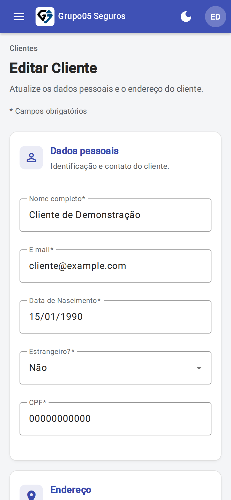

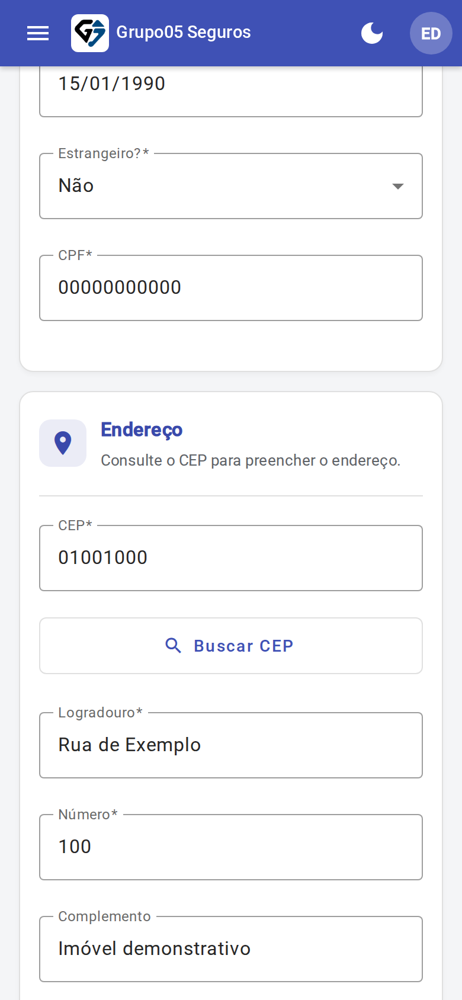

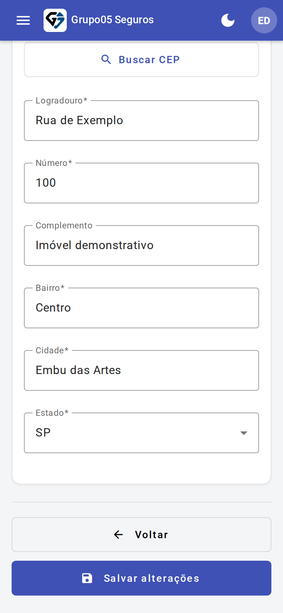

Fonte: captura do aplicativo do repositório, emulação mobile de 390 × 844 pixels CSS, dados fictícios, 2026.

Correspondência com a versão desktop: Figura 11. Vistas sequenciais de rolagem: 2.

**Figura 20 — Lista integrada de cotações na versão mobile**

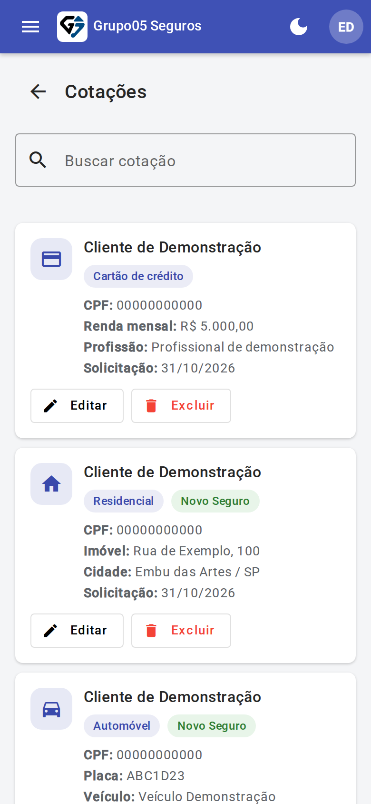

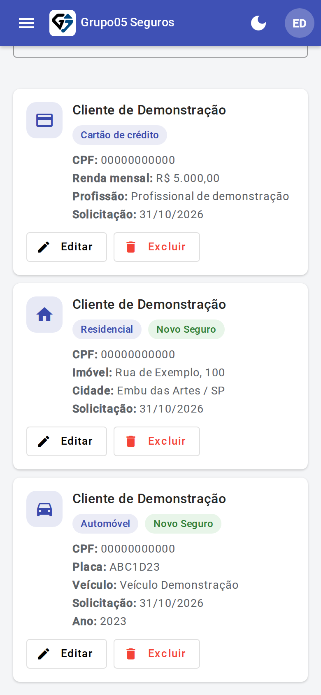

Fonte: captura do aplicativo do repositório, emulação mobile de 390 × 844 pixels CSS, dados fictícios, 2026.

Correspondência com a versão desktop: Figura 8. Vistas sequenciais de rolagem: 4.

**Figura 21 — Cotação de automóvel na versão mobile**

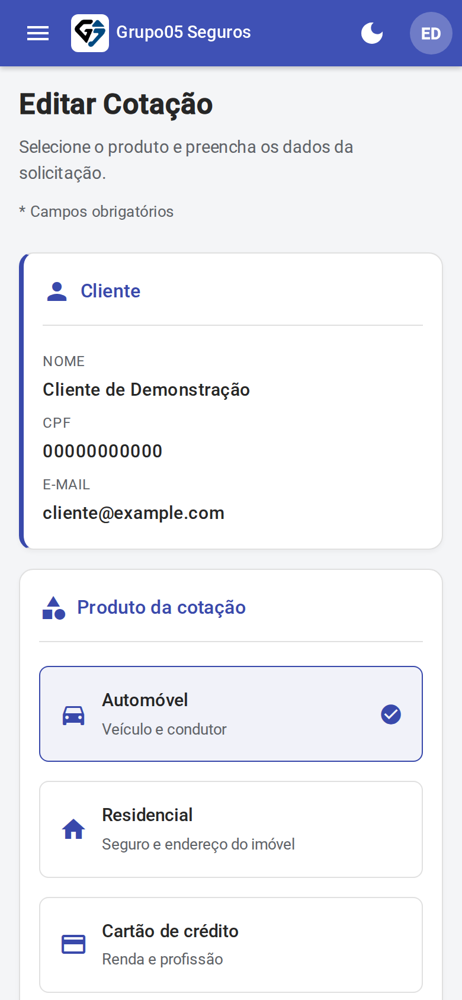

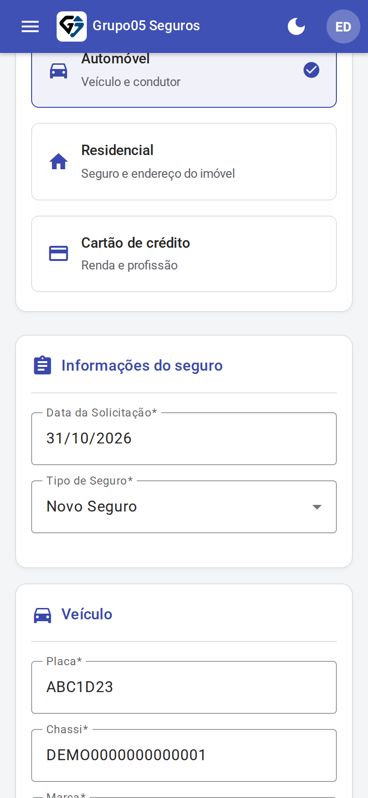

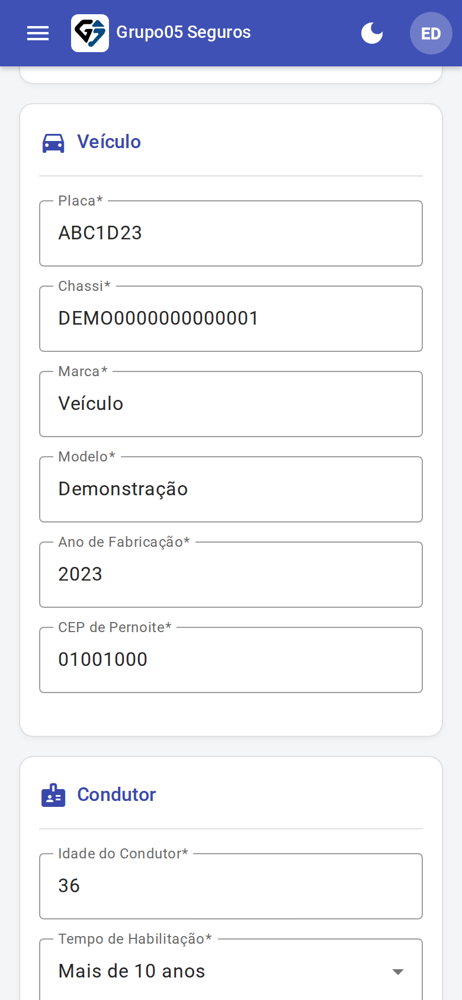

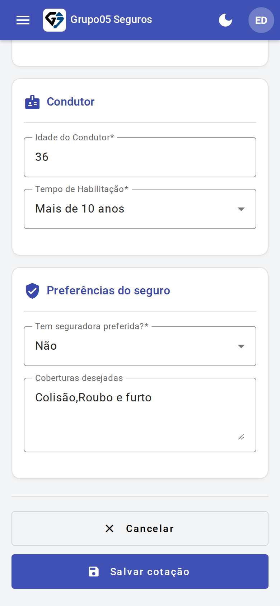

Fonte: captura do aplicativo do repositório, emulação mobile de 390 × 844 pixels CSS, dados fictícios, 2026.

Correspondência com a versão desktop: Figura 9. Vistas sequenciais de rolagem: 4.

**Figura 22 — Cotação de seguro residencial na versão mobile**

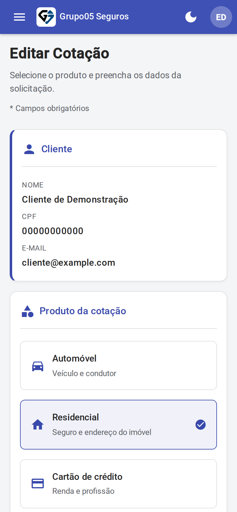

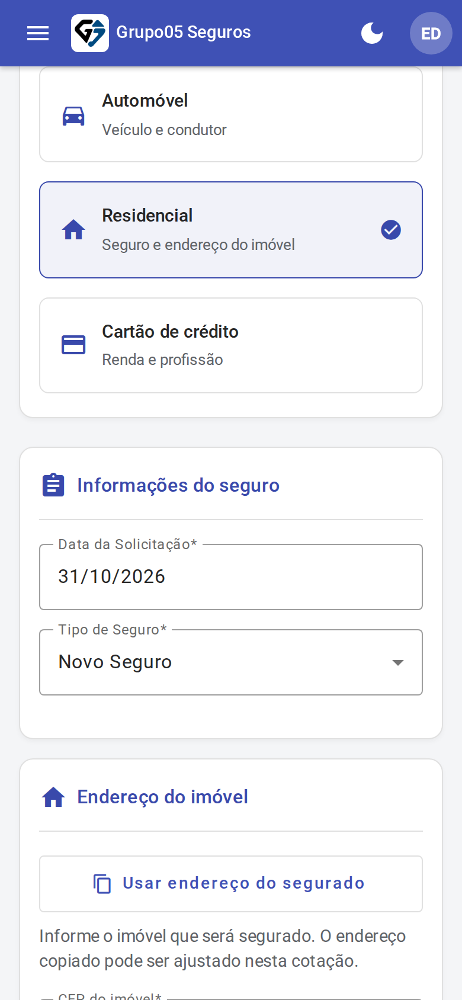

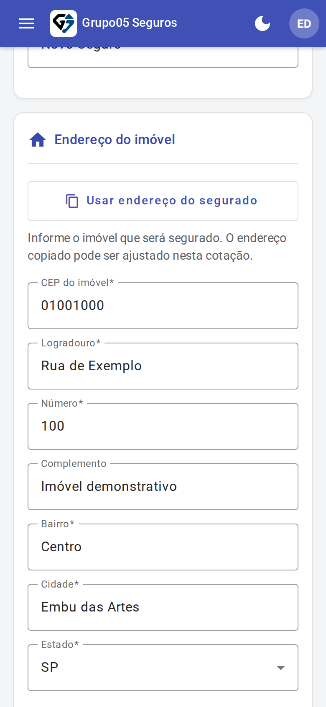

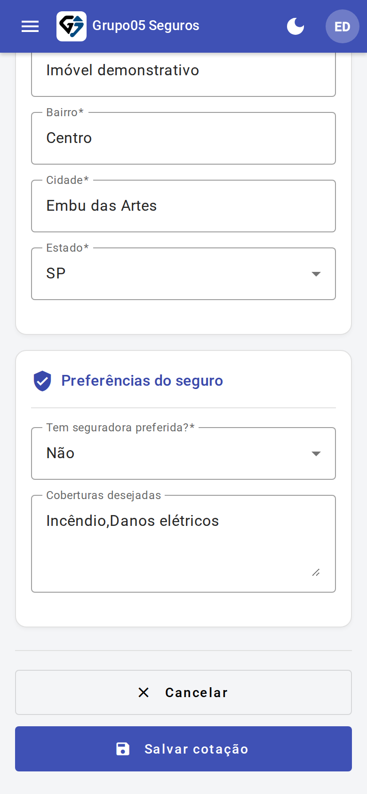

Fonte: captura do aplicativo do repositório, emulação mobile de 390 × 844 pixels CSS, dados fictícios, 2026.

Correspondência com a versão desktop: Figura 10. Vistas sequenciais de rolagem: 2.

**Figura 23 — Solicitação de cartão de crédito na versão mobile**

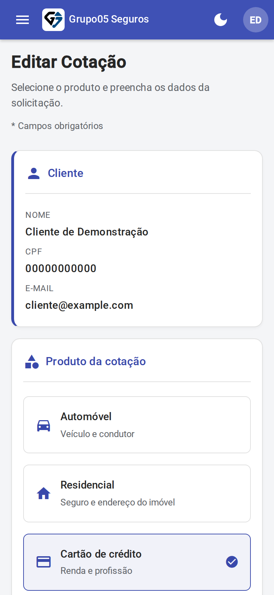

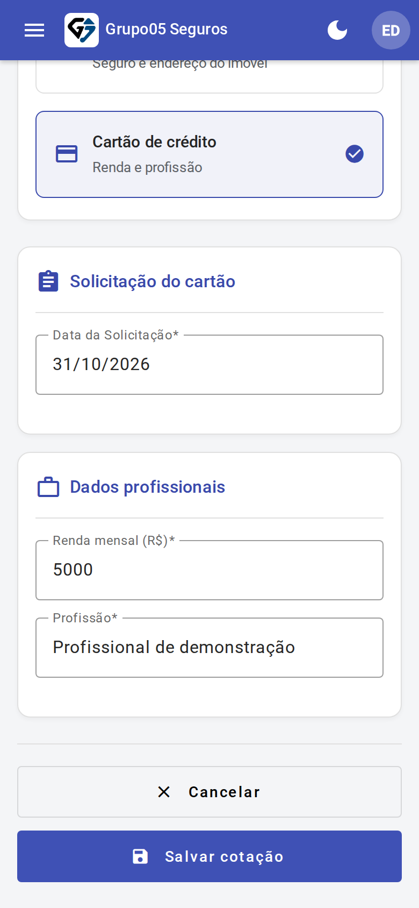

Fonte: captura do aplicativo do repositório, emulação mobile de 390 × 844 pixels CSS, dados fictícios, 2026.

Correspondência com a versão desktop: Figura 13. Vista da interface em tela móvel.

**Figura 24 — Lista de usuários na versão mobile**

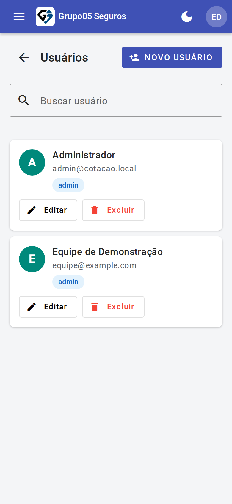

Fonte: captura do aplicativo do repositório, emulação mobile de 390 × 844 pixels CSS, dados fictícios, 2026.

Correspondência com a versão desktop: Figura 14. Vista da interface em tela móvel.

**Figura 25 — Cadastro de usuário na versão mobile**

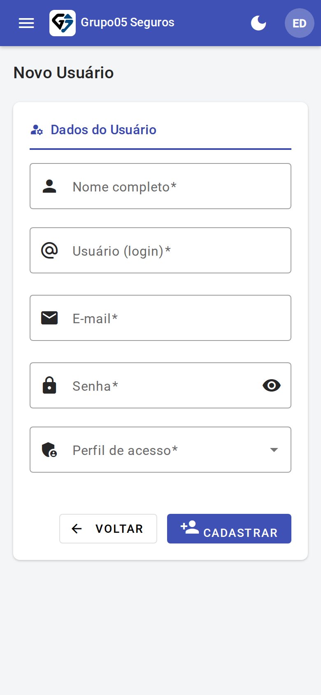

Fonte: captura do aplicativo do repositório, emulação mobile de 390 × 844 pixels CSS, dados fictícios, 2026.

Correspondência com a versão desktop: Figura 12. Vista da interface em tela móvel.

**Figura 26 — Painel com tema escuro na versão mobile**

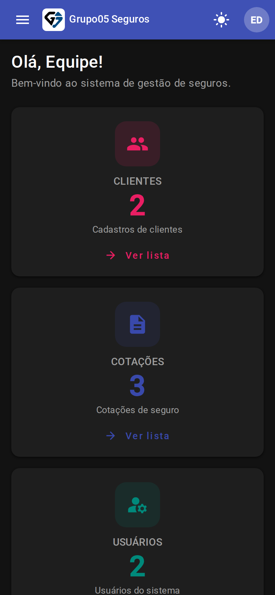

Fonte: captura do aplicativo do repositório, emulação mobile de 390 × 844 pixels CSS, dados fictícios, 2026.
